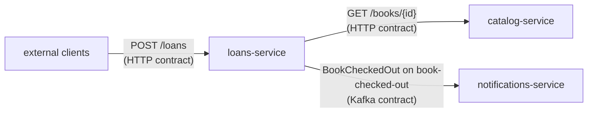

# Stubborn Contract Demo

As I wanted to learn about [Stubborn Contract](https://stubborn.sh), I asked Claude
to guide me through a demo project: this is the result.

## Domain

The domain is a (book) library, and the interactions are deliberately basic.



## Testing

At the root, run:

```
./gradlew clean check
```

If you'd rather focus on just one module, then run one of the following:

```
./gradlew :catalog-service:clean :catalog-service:check
```

```
./gradlew :loans-service:clean :loans-service:check
```

```
./gradlew :notifications-service:clean :notifications-service:check
```
 